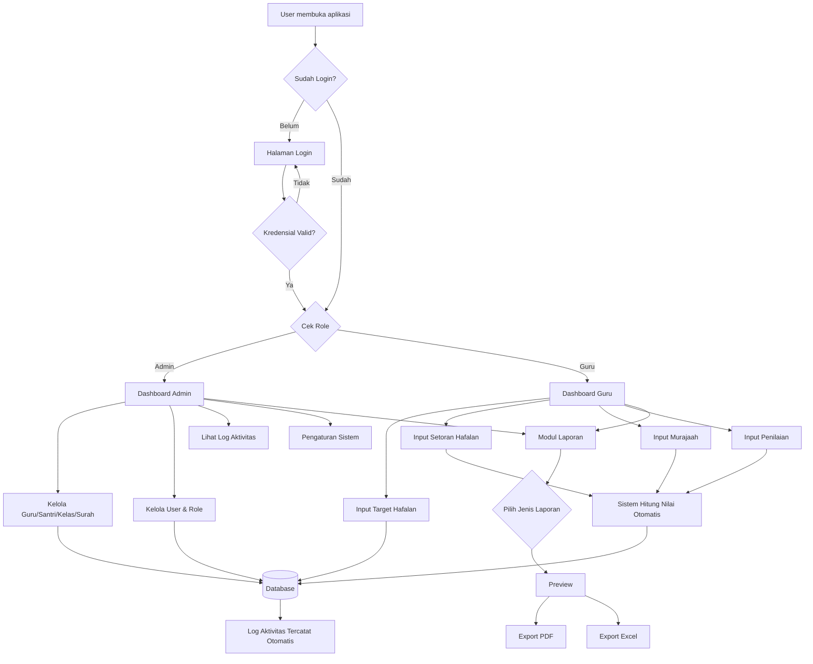
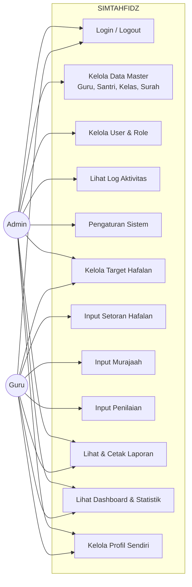
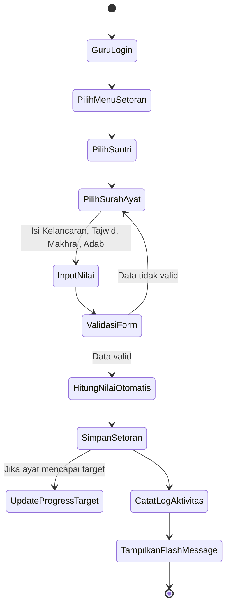
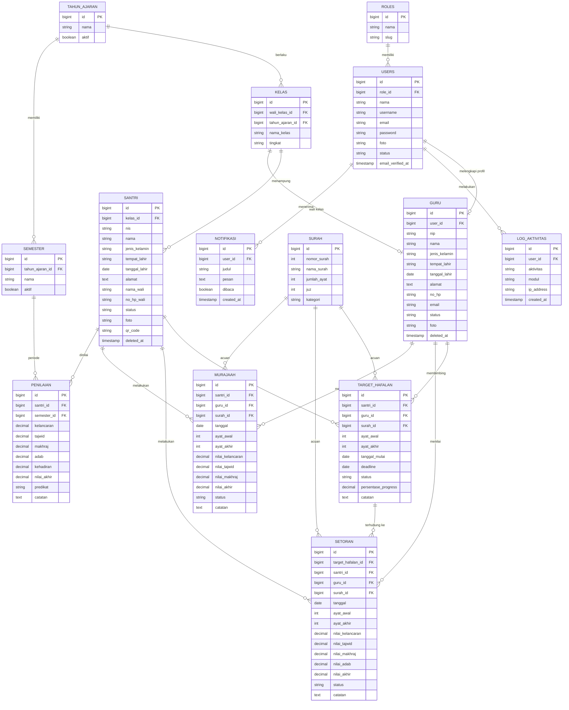

# SIMTAHFIDZ — Sistem Informasi Manajemen Hafalan Al-Qur'an
## Dokumen Perencanaan Sistem (Tahap Analisis & Desain)

> Dokumen ini adalah tahap **wajib sebelum implementasi kode**, mencakup analisis kebutuhan, diagram sistem, ERD, struktur folder, daftar migration/model/controller/route, wireframe, desain dashboard, dan roadmap pengembangan.

---

## 1. Analisis Kebutuhan Sistem

### 1.1 Kebutuhan Fungsional

| Kode | Kebutuhan | Aktor |
|---|---|---|
| F-01 | Login, logout, lupa password | Admin, Guru |
| F-02 | Kelola data Guru (CRUD) | Admin |
| F-03 | Kelola data Santri (CRUD) | Admin |
| F-04 | Kelola data Kelas (CRUD) | Admin |
| F-05 | Kelola master Surah (CRUD) | Admin |
| F-06 | Kelola Target Hafalan | Admin, Guru |
| F-07 | Input & kelola Setoran Hafalan | Guru |
| F-08 | Input & kelola Murajaah | Guru |
| F-09 | Kelola Penilaian per semester | Guru |
| F-10 | Lihat & cetak Laporan (PDF/Excel) | Admin, Guru |
| F-11 | Kelola akun User & Role | Admin |
| F-12 | Lihat Log Aktivitas (audit trail) | Admin |
| F-13 | Pengaturan aplikasi (tahun ajaran, semester aktif, profil sekolah) | Admin |
| F-14 | Dashboard statistik & grafik real-time | Admin, Guru |
| F-15 | Notifikasi sistem | Admin, Guru |
| F-16 | Pencarian, filter, sorting, pagination di semua modul data | Admin, Guru |
| F-17 | Export/Import Excel data santri & rekap | Admin |
| F-18 | Cetak kartu/QR Code santri | Admin |

### 1.2 Kebutuhan Non-Fungsional

| Kategori | Deskripsi |
|---|---|
| **Usability** | UI modern, responsif (mobile-first), konsisten memakai AdminLTE + Bootstrap 5 |
| **Security** | Auth Laravel, CSRF, hashing bcrypt, role & permission middleware, rate limiter login, mass-assignment protection |
| **Performance** | Eager loading relasi, index database, pagination, cache ringan pada dashboard |
| **Maintainability** | Pola MVC + Service/Repository layer, SOLID, kode reusable (Blade Components) |
| **Reliability** | Validasi form ketat (Form Request), transaction DB pada operasi kritikal, logging error |
| **Auditability** | Audit trail via `log_aktivitas` pada setiap create/update/delete |
| **Scalability** | Struktur modul terpisah per domain, siap ditambah modul Santri Portal / API mobile di versi lanjutan |

### 1.3 Ruang Lingkup (Scope)

* Versi pertama **hanya** digunakan oleh **Admin** dan **Guru**. Santri belum memiliki akun/login.
* Data santri, kelas, dan surah dikelola terpusat oleh Admin.
* Guru fokus pada input transaksi harian (setoran, murajaah) dan penilaian.
* Laporan bersifat lintas periode (bulanan/tahunan) dan lintas kelas/guru.

### 1.4 Batasan Sistem

* Tidak ada modul pembayaran/SPP.
* Tidak ada aplikasi mobile native (disiapkan agar mudah dibuatkan API di masa depan).
* Notifikasi bersifat notifikasi internal aplikasi (database notification), bukan WhatsApp/SMS gateway (dapat dikembangkan di roadmap lanjutan).

---

## 2. Diagram Alur Sistem (System Flow)



---

## 3. Use Case Diagram



**Catatan desain:** Target Hafalan bisa dibuat Admin maupun Guru (Admin mengawasi seluruh kelas, Guru fokus pada santri binaannya) — dipisahkan lewat *policy* `TargetHafalanPolicy`, bukan lewat menu terpisah, agar kode controller reusable untuk kedua role.

---

## 4. Activity Diagram — Proses Input Setoran Hafalan



---

## 5. Entity Relationship Diagram (ERD)



---

## 6. Relasi Database (Penjelasan)

| Relasi | Jenis | Keterangan |
|---|---|---|
| `roles` → `users` | 1 : N | Satu role dipakai banyak user |
| `users` → `guru` | 1 : 1 | Akun guru terhubung ke profil guru |
| `tahun_ajaran` → `kelas` | 1 : N | Kelas berlaku pada satu tahun ajaran |
| `tahun_ajaran` → `semester` | 1 : N | Tiap tahun ajaran punya semester ganjil/genap |
| `guru` → `kelas` | 1 : N (nullable) | Guru sebagai wali kelas (opsional) |
| `kelas` → `santri` | 1 : N | Satu kelas berisi banyak santri |
| `santri`, `guru`, `surah` → `target_hafalan` | N : 1 masing-masing | Target dimiliki 1 santri, dibimbing 1 guru, acuan 1 surah |
| `target_hafalan` → `setoran` | 1 : N (nullable FK) | Setoran dapat dikaitkan ke target aktif untuk update progress otomatis |
| `santri`, `guru`, `surah` → `setoran` | N : 1 masing-masing | — |
| `santri`, `guru`, `surah` → `murajaah` | N : 1 masing-masing | — |
| `santri`, `semester` → `penilaian` | N : 1 masing-masing | Satu santri punya satu nilai per semester (unique composite `santri_id + semester_id`) |
| `users` → `log_aktivitas` | 1 : N | Setiap aksi CRUD dicatat |
| `users` → `notifikasi` | 1 : N | Notifikasi personal per user |

**Normalisasi:** Struktur di atas sudah berada pada **3NF** — setiap kolom non-key bergantung penuh pada primary key dan tidak ada dependensi transitif (misalnya nama surah tidak diduplikasi ke tabel setoran/murajaah/target, melainkan direferensikan via `surah_id`).

**Soft Delete** diterapkan pada `guru` dan `santri` (data historis pada `setoran`/`penilaian` tetap valid walau data induk dihapus).

**Cascade Delete** diterapkan pada relasi anak murni seperti `kelas` → tidak cascade ke `santri` (gunakan `restrict`, agar admin tidak sengaja menghapus kelas berisi santri), sedangkan `target_hafalan` → `setoran` menggunakan `set null` (setoran tetap ada meski target dihapus).
# SIMTAHFIDZ — Struktur Teknis Aplikasi

## 7. Struktur Folder Laravel

```
simtahfidz/
├── app/
│   ├── Console/
│   ├── Exports/                    # Laravel Excel export classes
│   │   ├── SantriExport.php
│   │   ├── SetoranExport.php
│   │   ├── MurajaahExport.php
│   │   └── PenilaianExport.php
│   ├── Http/
│   │   ├── Controllers/
│   │   │   ├── Auth/
│   │   │   │   ├── LoginController.php
│   │   │   │   └── ForgotPasswordController.php
│   │   │   ├── DashboardController.php
│   │   │   ├── GuruController.php
│   │   │   ├── SantriController.php
│   │   │   ├── KelasController.php
│   │   │   ├── SurahController.php
│   │   │   ├── TargetHafalanController.php
│   │   │   ├── SetoranController.php
│   │   │   ├── MurajaahController.php
│   │   │   ├── PenilaianController.php
│   │   │   ├── LaporanController.php
│   │   │   ├── UserController.php
│   │   │   ├── LogAktivitasController.php
│   │   │   ├── PengaturanController.php
│   │   │   ├── ProfileController.php
│   │   │   └── NotifikasiController.php
│   │   ├── Middleware/
│   │   │   ├── EnsureUserIsActive.php
│   │   │   ├── RoleMiddleware.php
│   │   │   └── LogActivityMiddleware.php
│   │   └── Requests/
│   │       ├── Guru/StoreGuruRequest.php
│   │       ├── Guru/UpdateGuruRequest.php
│   │       ├── Santri/StoreSantriRequest.php
│   │       ├── Santri/UpdateSantriRequest.php
│   │       ├── Setoran/StoreSetoranRequest.php
│   │       ├── Murajaah/StoreMurajaahRequest.php
│   │       ├── Penilaian/StorePenilaianRequest.php
│   │       └── ... (per modul)
│   ├── Models/
│   │   ├── User.php
│   │   ├── Role.php
│   │   ├── Guru.php
│   │   ├── Santri.php
│   │   ├── Kelas.php
│   │   ├── Surah.php
│   │   ├── TahunAjaran.php
│   │   ├── Semester.php
│   │   ├── TargetHafalan.php
│   │   ├── Setoran.php
│   │   ├── Murajaah.php
│   │   ├── Penilaian.php
│   │   ├── LogAktivitas.php
│   │   └── Notifikasi.php
│   ├── Policies/
│   │   ├── SantriPolicy.php
│   │   ├── TargetHafalanPolicy.php
│   │   └── SetoranPolicy.php
│   ├── Providers/
│   │   └── AppServiceProvider.php
│   ├── Services/
│   │   ├── PenilaianService.php        # logika hitung nilai & predikat
│   │   ├── ProgressTargetService.php   # update progres target dari setoran
│   │   └── LogActivityService.php
│   └── Traits/
│       └── HasSearchFilterSort.php     # query scope reusable (search/filter/sort)
├── database/
│   ├── factories/
│   ├── migrations/
│   └── seeders/
│       ├── RoleSeeder.php
│       ├── UserSeeder.php
│       ├── SurahSeeder.php            # seed 114 surah
│       ├── TahunAjaranSeeder.php
│       └── DatabaseSeeder.php
├── resources/
│   └── views/
│       ├── layouts/
│       │   ├── app.blade.php          # layout AdminLTE utama
│       │   └── auth.blade.php
│       ├── components/
│       │   ├── data-table.blade.php
│       │   ├── card-stat.blade.php
│       │   ├── form-input.blade.php
│       │   ├── form-select.blade.php
│       │   ├── flash-message.blade.php
│       │   ├── empty-state.blade.php
│       │   └── page-header.blade.php
│       ├── auth/login.blade.php
│       ├── dashboard/index.blade.php
│       ├── guru/{index,create,edit,show}.blade.php
│       ├── santri/{index,create,edit,show}.blade.php
│       ├── kelas/{index,create,edit}.blade.php
│       ├── surah/{index,create,edit}.blade.php
│       ├── target-hafalan/{index,create,edit}.blade.php
│       ├── setoran/{index,create,edit}.blade.php
│       ├── murajaah/{index,create,edit}.blade.php
│       ├── penilaian/{index,create,edit}.blade.php
│       ├── laporan/{index,progress,rekap-setoran,...}.blade.php
│       ├── user/{index,create,edit}.blade.php
│       ├── log-aktivitas/index.blade.php
│       ├── pengaturan/index.blade.php
│       └── pdf/                       # blade khusus untuk DomPDF
├── routes/
│   └── web.php
└── ...
```

**Keputusan desain:** Logika penghitungan nilai (bobot 40/30/20/10) dan update progress target **tidak** ditulis langsung di controller, melainkan dipindah ke `app/Services/*Service.php`. Ini memenuhi *Single Responsibility Principle* — controller hanya mengurus HTTP request/response, service mengurus business logic, sehingga mudah diuji (unit test) dan digunakan ulang (misalnya nanti dipanggil dari API).

---

## 8. Daftar Migration

| # | Nama Migration | Tabel |
|---|---|---|
| 1 | `create_roles_table` | roles |
| 2 | `create_users_table` (modifikasi bawaan + `role_id`, `foto`, `status`) | users |
| 3 | `create_tahun_ajaran_table` | tahun_ajaran |
| 4 | `create_semester_table` | semester |
| 5 | `create_guru_table` | guru |
| 6 | `create_kelas_table` | kelas |
| 7 | `create_santri_table` | santri |
| 8 | `create_surah_table` | surah |
| 9 | `create_target_hafalan_table` | target_hafalan |
| 10 | `create_setoran_table` | setoran |
| 11 | `create_murajaah_table` | murajaah |
| 12 | `create_penilaian_table` | penilaian |
| 13 | `create_log_aktivitas_table` | log_aktivitas |
| 14 | `create_notifikasi_table` | notifikasi |

Semua migration memakai foreign key berindeks, `softDeletes()` pada `guru` & `santri`, dan `timestamps()` standar.

---

## 9. Daftar Model & Relationship

| Model | Relasi Eloquent |
|---|---|
| `Role` | `hasMany(User::class)` |
| `User` | `belongsTo(Role::class)`, `hasOne(Guru::class)`, `hasMany(LogAktivitas::class)`, `hasMany(Notifikasi::class)` |
| `Guru` | `belongsTo(User::class)`, `hasMany(Kelas::class, 'wali_kelas_id')`, `hasMany(TargetHafalan::class)`, `hasMany(Setoran::class)`, `hasMany(Murajaah::class)` |
| `Santri` | `belongsTo(Kelas::class)`, `hasMany(TargetHafalan::class)`, `hasMany(Setoran::class)`, `hasMany(Murajaah::class)`, `hasMany(Penilaian::class)` |
| `Kelas` | `belongsTo(Guru::class, 'wali_kelas_id')`, `belongsTo(TahunAjaran::class)`, `hasMany(Santri::class)` |
| `Surah` | `hasMany(TargetHafalan::class)`, `hasMany(Setoran::class)`, `hasMany(Murajaah::class)` |
| `TahunAjaran` | `hasMany(Kelas::class)`, `hasMany(Semester::class)` |
| `Semester` | `belongsTo(TahunAjaran::class)`, `hasMany(Penilaian::class)` |
| `TargetHafalan` | `belongsTo(Santri::class)`, `belongsTo(Guru::class)`, `belongsTo(Surah::class)`, `hasMany(Setoran::class)` |
| `Setoran` | `belongsTo(TargetHafalan::class)`, `belongsTo(Santri::class)`, `belongsTo(Guru::class)`, `belongsTo(Surah::class)` |
| `Murajaah` | `belongsTo(Santri::class)`, `belongsTo(Guru::class)`, `belongsTo(Surah::class)` |
| `Penilaian` | `belongsTo(Santri::class)`, `belongsTo(Semester::class)` |
| `LogAktivitas` | `belongsTo(User::class)` |
| `Notifikasi` | `belongsTo(User::class)` |

Setiap model transaksional (`Setoran`, `Murajaah`, `Penilaian`, `TargetHafalan`) memiliki **accessor** `nilai_akhir_format` dan **scope** `scopeFilter()` dari trait `HasSearchFilterSort` agar index page mendukung search/filter/sort tanpa duplikasi query builder di controller.

---

## 10. Daftar Controller & Tanggung Jawab

| Controller | Tanggung Jawab Utama |
|---|---|
| `DashboardController` | Agregasi statistik + data grafik (Chart.js) untuk Admin/Guru |
| `GuruController` | CRUD Guru (Admin only) |
| `SantriController` | CRUD Santri (Admin only), generate QR Code |
| `KelasController` | CRUD Kelas (Admin only) |
| `SurahController` | CRUD Surah (Admin only) |
| `TargetHafalanController` | CRUD Target Hafalan (Admin & Guru, dibatasi Policy) |
| `SetoranController` | CRUD Setoran (Guru), memanggil `PenilaianService` & `ProgressTargetService` |
| `MurajaahController` | CRUD Murajaah (Guru) |
| `PenilaianController` | CRUD Penilaian per semester, memanggil `PenilaianService` |
| `LaporanController` | Menyediakan seluruh laporan: preview, export PDF (DomPDF), export Excel (Laravel Excel), dengan filter tanggal/kelas/guru |
| `UserController` | Kelola akun & role (Admin only) |
| `LogAktivitasController` | Menampilkan audit trail (read only, Admin only) |
| `PengaturanController` | Tahun ajaran, semester aktif, profil sekolah, backup DB |
| `ProfileController` | Update profil & password milik user login (Admin/Guru) |
| `NotifikasiController` | Menandai notifikasi dibaca, list notifikasi |
| `Auth\LoginController` | Login/logout/rate limiting |
| `Auth\ForgotPasswordController` | Reset password via email |

---

## 11. Daftar Middleware

| Middleware | Fungsi |
|---|---|
| `auth` (bawaan) | Memastikan user sudah login |
| `RoleMiddleware:admin` / `RoleMiddleware:guru` | Membatasi akses route berdasarkan role |
| `EnsureUserIsActive` | Menolak akses jika `status` user = nonaktif (auto logout) |
| `LogActivityMiddleware` | Mencatat setiap request POST/PUT/DELETE ke `log_aktivitas` |
| `throttle:login` | Rate limiter percobaan login (bawaan Laravel, dikonfigurasi ulang) |
| `verified` (opsional) | Jika verifikasi email diaktifkan |

---

## 12. Daftar Route (Ringkas)

```php
// routes/web.php (ringkasan struktur, lihat kode lengkap pada implementasi)

Route::middleware('guest')->group(function () {
    Route::get('login', [LoginController::class, 'create'])->name('login');
    Route::post('login', [LoginController::class, 'store']);
    Route::get('forgot-password', ...)->name('password.request');
});

Route::middleware(['auth', 'active'])->group(function () {
    Route::post('logout', [LoginController::class, 'destroy'])->name('logout');
    Route::get('dashboard', [DashboardController::class, 'index'])->name('dashboard');
    Route::get('profil', [ProfileController::class, 'edit'])->name('profile.edit');
    Route::put('profil', [ProfileController::class, 'update'])->name('profile.update');
    Route::patch('notifikasi/{id}/baca', [NotifikasiController::class, 'markAsRead']);

    // Modul yang bisa diakses Admin & Guru (dibatasi lebih detail via Policy)
    Route::resource('target-hafalan', TargetHafalanController::class);
    Route::resource('setoran', SetoranController::class)->except(['show']);
    Route::resource('murajaah', MurajaahController::class)->except(['show']);
    Route::resource('penilaian', PenilaianController::class)->except(['show']);
    Route::get('laporan', [LaporanController::class, 'index'])->name('laporan.index');
    Route::get('laporan/{jenis}', [LaporanController::class, 'preview'])->name('laporan.preview');
    Route::get('laporan/{jenis}/pdf', [LaporanController::class, 'exportPdf'])->name('laporan.pdf');
    Route::get('laporan/{jenis}/excel', [LaporanController::class, 'exportExcel'])->name('laporan.excel');

    Route::middleware('role:admin')->group(function () {
        Route::resource('guru', GuruController::class);
        Route::resource('santri', SantriController::class);
        Route::resource('kelas', KelasController::class);
        Route::resource('surah', SurahController::class);
        Route::resource('user', UserController::class);
        Route::get('log-aktivitas', [LogAktivitasController::class, 'index'])->name('log-aktivitas.index');
        Route::get('pengaturan', [PengaturanController::class, 'edit'])->name('pengaturan.edit');
        Route::put('pengaturan', [PengaturanController::class, 'update'])->name('pengaturan.update');
        Route::post('pengaturan/backup', [PengaturanController::class, 'backup'])->name('pengaturan.backup');
    });
});
```

**Keputusan desain:** Modul transaksi (Target/Setoran/Murajaah/Penilaian) sengaja **tidak** dipisah route Admin vs Guru — cukup satu resource route, lalu di dalam controller/Policy dicek: Guru hanya boleh melihat/mengubah data milik santri binaannya, sedangkan Admin melihat semua. Ini mengurangi duplikasi route & controller (DRY).
# SIMTAHFIDZ — Wireframe, Desain Dashboard & Roadmap

## 13. Wireframe Halaman (ASCII Layout)

### 13.1 Layout Umum (Sidebar + Topbar)
```
┌───────────────────────────────────────────────────────────────┐
│ [Logo] SIMTAHFIDZ            🔍 Cari...      🔔  👤 Nama ▾     │  ← Topbar
├───────────┬───────────────────────────────────────────────────┤
│ SIDEBAR   │  Breadcrumb: Dashboard / Santri / Tambah           │
│           │  ┌─────────────────────────────────────────────┐  │
│ Dashboard │  │  Judul Halaman           [+ Tambah Data]     │  │
│ Guru      │  ├─────────────────────────────────────────────┤  │
│ Santri    │  │            KONTEN HALAMAN (Card)             │  │
│ Kelas     │  │                                               │  │
│ Surah     │  └─────────────────────────────────────────────┘  │
│ Target    │                                                    │
│ Setoran   │                                                    │
│ Murajaah  │                                                    │
│ Penilaian │                                                    │
│ Laporan   │                                                    │
│ User      │                                                    │
│ Log       │                                                    │
│ Pengaturan│                                                    │
└───────────┴────────────────────────────────────────────────────┘
```

### 13.2 Wireframe Halaman List (Guru/Santri/Setoran/dll.)
```
┌───────────────────────────────────────────────────────────┐
│ Data Santri                              [+ Tambah Santri] │
├───────────────────────────────────────────────────────────┤
│ [Cari...........] [Filter Kelas ▾] [Filter Status ▾] [⤓Export] │
├───────────────────────────────────────────────────────────┤
│ No | Foto | NIS | Nama | Kelas | Wali | Status | Aksi      │
│  1 | 🖼️  | 001 | Ahmad| 7A    | ..   | Aktif  | 👁 ✏ 🗑     │
│  2 | 🖼️  | 002 | Budi | 7A    | ..   | Aktif  | 👁 ✏ 🗑     │
├───────────────────────────────────────────────────────────┤
│  (Empty state ilustrasi jika data kosong)                  │
├───────────────────────────────────────────────────────────┤
│ Menampilkan 1–10 dari 50 data          « 1 2 3 4 5 »        │
└───────────────────────────────────────────────────────────┘
```

### 13.3 Wireframe Form Input Setoran
```
┌───────────────────────────────────────────────────────────┐
│ Input Setoran Hafalan                                      │
├───────────────────────────────────────────────────────────┤
│ Tanggal: [ 📅 ]              Santri: [ Select2 ▾ ]          │
│ Surah:   [ Select2 ▾ ]       Ayat Awal: [__]  Ayat Akhir:[__]│
│ ─────────────── Penilaian ───────────────                  │
│ Kelancaran (40%) [slider/number 0-100]                      │
│ Tajwid      (30%) [slider/number 0-100]                     │
│ Makhraj     (20%) [slider/number 0-100]                     │
│ Adab        (10%) [slider/number 0-100]                     │
│ Nilai Akhir (otomatis): 88.5   Predikat: A   ← live preview  │
│ Catatan: [ textarea ]                                       │
│                              [Batal]   [Simpan Setoran]      │
└───────────────────────────────────────────────────────────┘
```
Perhitungan nilai akhir ditampilkan **live** memakai sedikit JavaScript (tanpa reload), namun tetap dihitung ulang & divalidasi di server (`PenilaianService`) — JS hanya untuk UX, bukan sumber kebenaran data.

### 13.4 Wireframe Halaman Laporan
```
┌───────────────────────────────────────────────────────────┐
│ Laporan Progress Hafalan                                   │
├───────────────────────────────────────────────────────────┤
│ Filter: [Tanggal Awal][Tanggal Akhir][Kelas▾][Guru▾][Terapkan]│
├───────────────────────────────────────────────────────────┤
│                     (Tabel Preview Laporan)                │
├───────────────────────────────────────────────────────────┤
│                                    [🖨 Cetak PDF] [⤓ Excel]  │
└───────────────────────────────────────────────────────────┘
```

---

## 14. Desain UI Dashboard

```
┌─────────────────────────────────────────────────────────────────┐
│  Selamat datang, Ustadz Fulan 👋           Semester Ganjil 2025/26│
├───────────┬───────────┬───────────┬───────────┬─────────────────┤
│ 👨‍🏫 Guru   │ 🧒 Santri  │ 🏫 Kelas  │ 📥 Setoran │ 🎯 Target Aktif │
│    12     │    240     │    8      │  Hari Ini: 34│      57       │
│ Card Emerald gradient + icon Bootstrap, angka besar, trend kecil  │
├───────────┴───────────┴───────────┴───────────┴─────────────────┤
│ ┌───────────────── Grafik Setoran Bulanan (Line) ─────────────┐  │
│ │  Chart.js — sumbu X: bulan, sumbu Y: jumlah setoran         │  │
│ └──────────────────────────────────────────────────────────────┘ │
│ ┌──────── Grafik Target Hafalan (Donut) ───┐ ┌ Grafik Nilai (Bar)┐│
│ │ Selesai / Berjalan / Terlambat           │ │ Rata² per kelas   ││
│ └───────────────────────────────────────────┘ └───────────────────┘│
│ ┌────────── Santri Teraktif (Top 5) ───────┐ ┌ Aktivitas Terbaru ┐│
│ │ List + avatar + jumlah setoran            │ │ Timeline log       ││
│ └────────────────────────────────────────────┘ └───────────────────┘│
│ Quick Actions: [+ Setoran] [+ Murajaah] [+ Target] [Lihat Laporan] │
└─────────────────────────────────────────────────────────────────┘
```

**Keputusan desain warna:** Emerald (`#0F9D58`/`#059669`) sebagai warna primer aksi & sidebar aktif, putih sebagai background card, abu terang (`#F3F4F6`) sebagai background halaman, dan aksen emas (`#D4AF37`) dipakai terbatas pada badge "Predikat A" / highlight pencapaian target — supaya tidak berlebihan dan tetap terlihat elegan/enterprise, bukan mencolok seperti aplikasi konsumer.

Efek **glassmorphism ringan** hanya diterapkan pada topbar & card statistik dashboard (`backdrop-filter: blur(8px)` + latar transparan tipis), tidak dipakai di seluruh halaman agar tabel data tetap terbaca jelas (kontras tinggi diprioritaskan di atas tren visual).

---

## 15. Roadmap Pengembangan

| Fase | Cakupan | Estimasi |
|---|---|---|
| **Fase 0 — Fondasi** | Setup Laravel 12, autentikasi, role middleware, layout AdminLTE, seeder role/user/surah | 2–3 hari |
| **Fase 1 — Master Data** | CRUD Guru, Santri, Kelas, Surah, Tahun Ajaran/Semester + upload foto | 3–4 hari |
| **Fase 2 — Transaksi Inti** | Target Hafalan, Setoran, Murajaah + Service perhitungan nilai & progress otomatis | 4–5 hari |
| **Fase 3 — Penilaian & Rapor** | Modul Penilaian semester + kalkulasi predikat otomatis | 2 hari |
| **Fase 4 — Dashboard & Grafik** | Statistik agregat + 4 grafik Chart.js + quick actions | 2 hari |
| **Fase 5 — Laporan** | Semua laporan: preview, filter, export PDF (DomPDF) & Excel (Laravel Excel) | 3 hari |
| **Fase 6 — Administrasi Sistem** | Kelola User & Role, Log Aktivitas, Pengaturan, Backup DB | 2 hari |
| **Fase 7 — Penyempurnaan** | Dark mode, notifikasi, QR Code santri, empty state, loading indicator, audit UX polish | 2–3 hari |
| **Fase 8 — Hardening & Testing** | Unit test Service, feature test CRUD, review keamanan (CSRF, rate limit, policy), optimasi query & index | 2–3 hari |
| **Fase 9 (Roadmap Lanjutan / v2)** | Portal login Santri, notifikasi WhatsApp Gateway, API mobile (Sanctum), multi-cabang pesantren | Pengembangan lanjutan |

Total estimasi MVP (Fase 0–8): **± 22–28 hari kerja** untuk satu developer, dapat dipercepat bila dikerjakan tim kecil (backend 1 orang + UI 1 orang paralel dari Fase 1).

---

Dokumen perencanaan selesai. Implementasi kode (migration, model, controller, view, route lengkap) mengikuti seluruh keputusan desain pada dokumen ini, dan tersedia pada folder proyek `simtahfidz/` yang menyertai dokumen ini.
